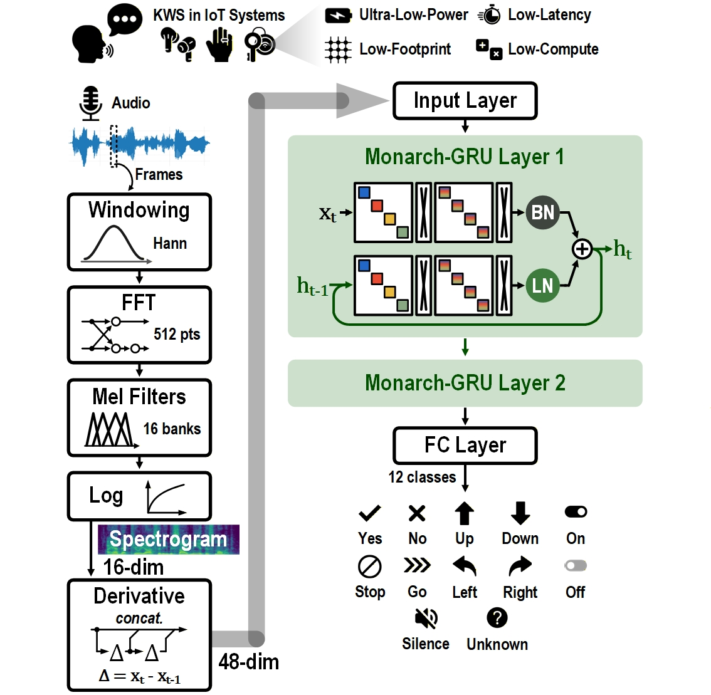
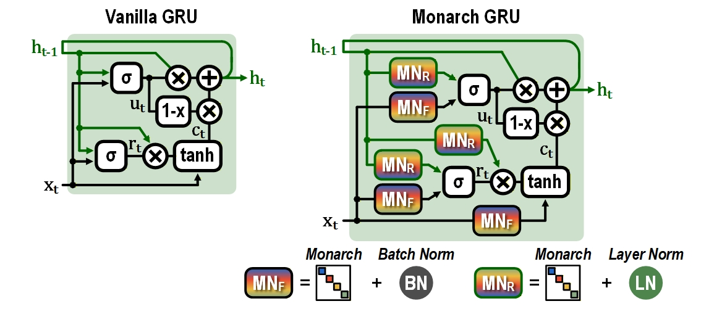

# MonarchGRU: low-footprint recurrent neural network for keyword spotting

MonarchGRU is a **29K-parameter** recurrent neural network for **always-on** keyword spotting on IoT
devices. It replaces most GRU weight matrices with Monarch matrices, which with 4 blocks need half the
weights and multiply-accumulates (MACs) of a dense matrix.

**[AICAS'26][AICAS26] | DOI: coming soon | [Citation](#citation)**

**MonarchGRU: A Low-Footprint Recurrent Neural Network for Audio Keyword Spotting System**<br>
2026 IEEE 8th International Conference on Artificial Intelligence Circuits and Systems (AICAS 2026), pp. 310–314<br>
Soujanya Bhowmick<sup>1</sup>, Sangyeob Kim<sup>2</sup>, Qinyu Chen<sup>3</sup>, Chang Gao<sup>4</sup>, Kwantae Kim<sup>1,&#42;</sup><br>
<sup>1</sup>Aalto University, Finland &nbsp; <sup>2</sup>Yonsei University, South Korea &nbsp;
<sup>3</sup>Leiden University, The Netherlands &nbsp; <sup>4</sup>TU Delft, The Netherlands<br>
<sup>&#42;</sup>Corresponding author

<p align="center">
  
  <br><em>Keyword spotting with MonarchGRU. Fig. 1 of the paper, © 2026 IEEE.</em>
</p>

---

This repo contains the PyTorch code to train and test MonarchGRU on the 12-class
[Google Speech Commands v2][GSC] task (10 keywords, plus *unknown* and *silence*), and a trained
checkpoint of the model with hidden size h = 64 and b = 4 Monarch blocks. Each one-second clip becomes
16 log-Mel coefficients per 10 ms frame, plus their first and second time derivatives: 48 features × 101
frames. Please see our paper ([AICAS 2026 proceedings][AICAS26], pp. 310–314) for the full results and
the comparison with other keyword-spotting models.

Instructions: **[Setup](#setup) | [Data](#data) | [Training](#training) | [Pretrained model](#pretrained-model)**

## News

- **Sep 2026:** MonarchGRU appeared at [AICAS 2026][AICAS-site] in an oral session (Ha Long Bay, Vietnam,
  16–18 September 2026). The paper is in the conference proceedings, pp. 310–314.

## Method

An always-on keyword spotter keeps its weights in on-chip SRAM, and in earlier keyword-spotting chips
the weight SRAM takes 41–56% of the accelerator power. A GRU layer with input size d and hidden size h
has 3h(d + h) weights, so its memory and MACs grow with h².

MonarchGRU replaces each h × h matrix with a Monarch matrix M = P L Pᵀ R. L and R are block-diagonal with
b blocks, and P is a fixed stride permutation, which is only wiring and has no weights. This needs 2h²/b
weights and MACs instead of h², so half at b = 4. In layer 1 the input matrices (h × 48) stay dense and
the hidden matrices use Monarch. In layer 2 both are Monarch.

Each gate also gets dual-path normalization: batch normalization on its input projection and layer
normalization on its recurrent projection. In the paper, this raises the test accuracy of the b = 4 model
at h = 64 from 96.95% to 97.94% (Table II).

<p align="center">
  
  <br><em>Vanilla GRU cell (left) and MonarchGRU cell with dual-path normalization (right). Fig. 3 of the paper, © 2026 IEEE.</em>
</p>

## Results

Test accuracy on the 12-class Google Speech Commands v2 test set, as reported in the paper
(Tables I and III; two layers, b = 4, dual-path normalization):

| Hidden size h | Parameters | MACs per clip | Accuracy (%) |
|---:|---:|---:|---:|
| 16 | 3.9 K | 349 K | 94.36 |
| 32 | 10.0 K | 0.93 M | 96.87 |
| 48<sup>†</sup> | 15.0 K | 1.4 M | 97.32 |
| 64 | 29.2 K | 2.8 M | 97.94 |

<sup>†</sup> At h = 48 the layer-1 input matrices are square (48 × 48), so they use Monarch as well
(in this code: `--hidden_size 48 --no-dense_input_layer1`, 14,988 parameters).

The models in the table were trained for 500 epochs. The training command below is for h = 64, b = 4;
for the other rows, change `--hidden_size` (for h = 48, also replace `--dense_input_layer1` with
`--no-dense_input_layer1`; see <sup>†</sup>). Accuracy changes a little from seed to seed.

## Getting started

### Setup

- Clone the repo and create the conda environment:
  ```sh
  git clone https://github.com/TSircGroup/monarchgru.git
  cd monarchgru
  conda env create -f env.yml
  conda activate monarch-gru-env
  ```
  The environment is for Linux with an NVIDIA GPU whose driver supports CUDA 12.8 or newer. On a machine
  without such a driver (for example a cluster login node), create it with
  `CONDA_OVERRIDE_CUDA=12.9 conda env create -f env.yml`. `env.yml` lists the main packages at the versions
  we use: Python 3.12, PyTorch 2.13, torchaudio 2.11 and CUDA 12.9, on V100 GPUs.

- Check the install. This builds the model and prints its size (29,196 parameters); no data is needed:
  ```sh
  python main.py --check_model
  ```
  It reads no audio, so it does not check torchaudio and torchcodec (training and `inference.py` use them).
  Run this and all later commands from the repository folder: `main.py` reads `./data` and writes
  `./Results` in the current folder.

### Data

Add `--download` to your first training command. It downloads Speech Commands v2 and its official test
set into `./data` and builds the 12-class split (about 12 GB of disk space in total):

```
data/
  speech_commands_v0.02/
    train_12class/
    valid_12class/
    _background_noise_/
  speech_commands_v0.02_split/
  speech_commands_test_set_v0.02/
```

The download runs at the start of the first training run, so the machine it runs on (for a Slurm job, the
compute node) needs internet access. Start other training runs only after that run has printed
`Download and 12-class split finished.`; until then the 12-class split is incomplete.

Use `--download` only once: each time, it deletes `data/speech_commands_v0.02` and
`data/speech_commands_test_set_v0.02` and downloads them again. If you already have the data in this
layout, link it instead: `ln -s /path/to/data data` (`--download` refuses to run when `./data` is a link).

To only measure the pretrained model's test accuracy, the test set alone is enough; see
[Pretrained model](#pretrained-model).

### Training

- Train the h = 64, b = 4 model with the settings in `submit_mn4.sh`:
  ```sh
  export CUBLAS_WORKSPACE_CONFIG=:4096:8
  python -u main.py \
    --hidden_size 64 --nblocks 4 --num_layers 2 --layer_dropout 0.0 \
    --epochs 1000 --batch_size 128 --lr 0.005 --weight_decay 0.03 --grad_clip 4.0 \
    --warmup_epochs 20 --label_smoothing 0.05 --lr_schedule cos --optimizer adamw \
    --n_mels 16 --use_deltas --specaug --freq_mask 7 --time_mask 20 \
    --use_swa --swa_start_frac 0.98 --valid_silence_noise --resample_unknown \
    --norm dual --dense_input_layer1 --seed 456 --gpu 0 --deterministic \
    --run_name my_run
  ```
  Replace `my_run` with a new name for every run. One epoch takes about 2 to 4 minutes on a V100, so the
  1000 epochs take about 1.5 to 3 days; the run needs up to about 35 GB of host memory. On a Slurm
  cluster, `sbatch submit_mn4.sh` runs the same
  command with the Slurm job ID as the run name; add `--download` to it for the first job only (see
  [Data](#data) before you submit more jobs), and adjust its partition and module lines for your cluster.

- The results are saved in `Results/my_run/`:
  - `gru.pt`: weights of the epoch with the best validation accuracy. `gru_last.pt`: weights after the
    last epoch.
  - `gru_selected.pt`: the checkpoint used for the test; with `--use_swa` it is the average of the
    weights of the last 20 epochs. `selection.json`: how it was chosen, and all run settings.
  - `test_evaluation.json`: test accuracy, confusion matrix and per-clip predictions.
    `final_metrics.json`: summary of the validation and test accuracy.
  - `validation_predictions.json`: the chosen checkpoint's predictions on the validation set.
  - `*.pkl`: per-epoch curves (training loss, validation accuracy, learning rate, gradient norm,
    fraction of clipped steps) and the final test accuracy.

  The test set is scored once, after training, with `gru_selected.pt`.
  To compare settings, train a few seeds (`--seed 456`, `--seed 457`, ...). All options:
  `python main.py --help`.

### Pretrained model

`checkpoints/gru.pt` is a trained h = 64, b = 4 model (29,196 parameters). Its accuracy is 97.955% on the
official test set (4790 of 4890 clips); we picked it from our runs with the test results in view. The model
runs on the GPU, or on the CPU if there is no GPU.

- Predict the keyword in your own clips (mono 16 kHz WAV files of at most one second):
  ```sh
  python inference.py clip.wav more.wav
  ```
  After a short model summary, it prints one line per clip with the keyword and its probability, for
  example `clip.wav: yes (94.2%)`.
  The classes are `yes no up down left right on off stop go`, `_unknown_` and `_silence_`.

- Measure the accuracy on the official test set. This needs only the test set (113 MB), not the full
  dataset; skip the download steps if you already ran `--download` (see [Data](#data)):
  ```sh
  mkdir -p data/speech_commands_test_set_v0.02
  cd data/speech_commands_test_set_v0.02
  curl -LO https://storage.googleapis.com/download.tensorflow.org/data/speech_commands_test_set_v0.02.tar.gz
  tar -xzf speech_commands_test_set_v0.02.tar.gz
  cd ../..
  python inference.py --eval_test
  ```
  It prints `Test accuracy: 97.955% (4790/4890)`. `submit_inference.sh` runs the same evaluation as a
  Slurm job, on the CPU (its comments say how to use a GPU); as with `submit_mn4.sh`, adjust its
  partition and module lines for your cluster.

## Repository structure

| File | Contents |
|---|---|
| `main.py` | Training, validation and the final test |
| `inference.py` | Keyword prediction and test accuracy with `checkpoints/gru.pt` |
| `monarch_gru.py` | The MonarchGRU cell, layers and classifier |
| `monarch_linear.py`, `structured_linear.py`, `blockdiag_butterfly_multiply.py` | The Monarch layer, adapted from [HazyResearch/fly][fly] |
| `utils.py` | Dataset download and split, data loading, augmentation, log-Mel features |
| `checkpoints/gru.pt` | Trained h = 64, b = 4 model |
| `assets/` | Figures from the paper |
| `submit_mn4.sh`, `submit_inference.sh` | Slurm scripts for training and test evaluation |
| `env.yml` | Conda environment (the main packages) |
| `LICENSE`, `LICENSE-apache`, `LICENSE-bcresnet`, `NOTICE.md` | Licenses (see [License](#license)) |

## Citation

If you find our work useful, please consider citing our paper.

Conference publication in [AICAS'26][AICAS26]:

```bibtex
@inproceedings{2026-AICAS-Bhowmick-monarchgru,
    author={Bhowmick, Soujanya and Kim, Sangyeob and Chen, Qinyu and Gao, Chang and Kim, Kwantae},
    booktitle={2026 IEEE 8th International Conference on Artificial Intelligence Circuits and Systems (AICAS)},
    title={{MonarchGRU}: A Low-Footprint Recurrent Neural Network for Audio Keyword Spotting System},
    year={2026},
    volume={},
    number={},
    pages={310-314}
}
```

The DOI will be added when the paper is on IEEE Xplore.

## Acknowledgements

This work was supported by the MIcroELectronics (MIELi) doctoral pilot programme, funded by the Finnish
Ministry of Education and Culture.

The Monarch layer is adapted from [HazyResearch/fly][fly], the code of the Monarch paper
([Dao et al., ICML 2022][monarch]).
The data pipeline in `utils.py` is adapted from [Qualcomm-AI-research/bcresnet][bcresnet]
([Kim et al., Interspeech 2021][bcresnet-paper]).

## License

Our code and the checkpoint are released under the [MIT License](LICENSE). Some files keep the license
of the project they come from:
- `monarch_linear.py`, `structured_linear.py` and `blockdiag_butterfly_multiply.py` are modified from
  [HazyResearch/fly][fly] and stay under the Apache License 2.0 ([LICENSE-apache](LICENSE-apache)).
- Parts of `utils.py` (see [Acknowledgements](#acknowledgements)) stay under the BSD-3-Clause-Clear license
  ([LICENSE-bcresnet](LICENSE-bcresnet)), Copyright (c) 2023 Qualcomm Technologies, Inc.
- The figures in `assets/` are from the paper, © 2026 IEEE, and are not covered by the MIT License.

See [NOTICE.md](NOTICE.md) for details. Questions and bug reports: please open a GitHub issue.

[AICAS26]: https://2026.ieee-aicas.org/publication/
[AICAS-site]: https://2026.ieee-aicas.org/
[GSC]: https://arxiv.org/abs/1804.03209
[fly]: https://github.com/HazyResearch/fly
[monarch]: https://arxiv.org/abs/2204.00595
[bcresnet]: https://github.com/Qualcomm-AI-research/bcresnet
[bcresnet-paper]: https://arxiv.org/abs/2106.04140
